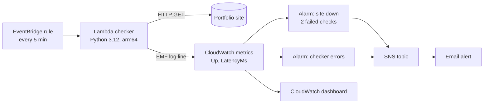
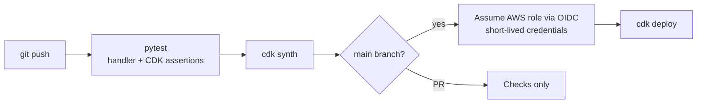

# AWS Uptime Monitor (Serverless, AWS CDK, OIDC)


A small serverless monitor that checks my portfolio site (https://shobhin15.github.io) every 5 minutes and emails me if it goes down. Everything is defined in **AWS CDK (Python)** and deployed from **GitHub Actions using OIDC**, so no AWS access keys are stored anywhere.

## Architecture



**How it works**

- **EventBridge** triggers the **Lambda** every 5 minutes.
- The Lambda fetches the site, checks for HTTP 200 and that the page contains my name, and measures latency.
- It writes the result as a CloudWatch **Embedded Metric Format** log line. CloudWatch turns that into `Up` and `LatencyMs` metrics without extra API calls or IAM permissions.
- A **CloudWatch alarm** fires after two failed checks in a row and emails me through **SNS**. It also emails when the site recovers.
  - Missing data counts as failing, so I also get alerted if the checker itself stops running.
- A second alarm catches errors in the Lambda itself, and a **dashboard** shows uptime and latency.

## CI/CD with OIDC



- **Tests:** unit tests for the checker logic (healthy, wrong content, HTTP errors, network errors, metric format), plus CDK assertion tests that check the synthesized CloudFormation (runtime, schedule, alarms, email subscription, log retention, and the OIDC trust policy).
- **OIDC:** GitHub Actions gets a short-lived token, and AWS trusts it only for this repo's `main` branch. The deploy role can do nothing except assume the CDK bootstrap roles.

## One-time setup

You need an AWS account with the AWS CLI configured locally (`aws configure` or `aws sso login`), Node.js, and Python 3.12.

```bash
# 1. Install dependencies
python3 -m venv .venv && source .venv/bin/activate
pip install -r requirements.txt -r requirements-dev.txt
npm install -g aws-cdk@2

# 2. Run the tests locally
pytest -v

# 3. Bootstrap CDK in your account and region (once per account/region)
cdk bootstrap aws://$(aws sts get-caller-identity --query Account --output text)/us-east-1

# 4. Create the GitHub OIDC provider and deploy role (once)
cdk deploy GithubOidcStack -c githubRepo=shobhin15/aws-uptime-monitor
#    If your account already has a GitHub OIDC provider, reuse it:
#    cdk deploy GithubOidcStack -c githubOidcProviderArn=arn:aws:iam::<account>:oidc-provider/token.actions.githubusercontent.com
```

Copy the `DeployRoleArn` output. Then in GitHub, go to **Settings → Secrets and variables → Actions → Variables** and add:

| Variable | Value |
|---|---|
| `AWS_DEPLOY_ROLE_ARN` | the `DeployRoleArn` output |
| `AWS_REGION` | `us-east-1` |
| `ALERT_EMAIL` | where alerts should go |

Push to `main` (or re-run the workflow) and the deploy job takes it from there. AWS will email you a subscription confirmation; click the link to start getting alerts.

> Right after the first deploy, the "site down" alarm may briefly fire and then clear while the first data points arrive. That's expected.

## Cost

This fits in the AWS free tier: about 8,640 Lambda runs a month, 2 alarms, 1 dashboard, SNS email, and logs kept for 7 days.

## Tear down

```bash
cdk destroy UptimeMonitorStack GithubOidcStack
```

## Repository layout

```
.
├── app.py                              # CDK app entry point
├── uptime_monitor/
│   ├── monitor_stack.py                # Lambda, schedule, metrics, alarms, dashboard, SNS
│   └── github_oidc_stack.py            # OIDC provider + least-privilege deploy role
├── lambda/checker/handler.py           # the health check (standard library only)
├── tests/unit/                         # pytest: handler logic + CDK assertions
└── .github/workflows/ci-cd.yml         # test -> synth -> deploy via OIDC
```
